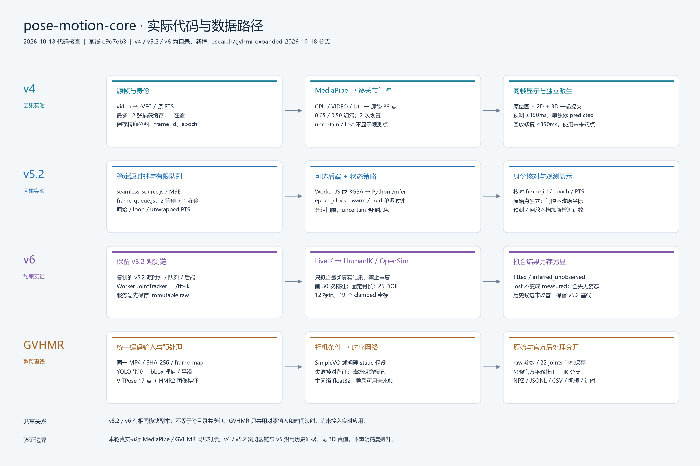

# 实际代码架构：v4、v5.2、v6 与 GVHMR

核查日期：2026-10-18。基线提交：`e9d7eb38f24f901d7935fde0e3da4907b9a562a9`。本轮评测分支：`research/gvhmr-expanded-2026-10-18`。

**Git 中原来只有 `main` / `origin/main`。v4、v5.2、v6 是历史实现目录，不是三个 Git 分支。** 本次新增独立工作树和评测分支；原 `main` 工作树的源码保持不变。GVHMR 是新的离线实验，尚未接入现有浏览器实时应用。

## 目录与入口

| 实现 | 实际位置 | 输入与输出 | 本轮验证状态 |
|---|---|---|---|
| v4 | `baselines/pose-live-v4/public/{app,pose-worker,joint-policy}.js` | 浏览器真实视频帧 → MediaPipe 33 点、关节状态、严格同帧显示、日志 | 本轮读代码；沿用归档测试证据，未重跑浏览器实测 |
| v5.2 | `baselines/v5.2/pose-v52/public/` 与 `pose-v52-python/` | MSE/视频帧 → 浏览器 JS 或 Python CPU MediaPipe → 原始点、逐关节门控、匹配画面 | 本轮离线对照使用相同 Lite 模型和 Python VIDEO 参数；没有重现浏览器队列/HTTP/显示链路 |
| v6 | `experiments/pose-ik-v6/src/` 与 `live-app/` | v5.2 原始观测与状态 → OpenSim 约束拟合 → 另存 fitted / inferred_unobserved | 本轮读实现及归档负面结论；没有在 laptop 新跑 OpenSim |
| GVHMR | `experiments/gvhmr-offline-laptop/scripts_v2/`；本地外部 `src/GVHMR-<commit>/` | 完整视频 → YOLO/ViTPose/HMR2/相机条件 → 时序网络 → 人体参数、相机/全局 22 关节 | 本轮真实加载权重并逐片运行；原始与官方后处理分别保留，结果见评测报告 |

## v4：逐关节质量门控和严格同帧显示

`app.js` 从 `requestVideoFrameCallback` 取得源 PTS，按源时钟释放帧，保留精确输入位图。最多 12 张捕获缓存、一次一个推理在途；返回后核对 frame_id / epoch / PTS，再一起提交对应视频、2D 和 3D。界面刷新率不是新推理率。切换片段、循环或跳转会清空应用历史并重建 Worker 模型。

`pose-worker.js` 使用 MediaPipe Pose Landmarker Lite、CPU、VIDEO、单人，检测/存在/跟踪阈值均 0.5。原始 33 点保持原样。`joint-policy.js` 的进入/退出阈值为 0.65/0.50，低于 0.35 为 lost；恢复要求两次合格样本，叠加有限值、跳变和骨长检查。仅 measured 点进入观测显示；uncertain/lost 返回空点。骨长基准的 0.9/0.1 更新用于异常检查，不是把输出坐标低通滤波。

`predict()` 使用过去两次 measured，最多外推 150ms；世界速度上限 6m/s、归一化速度上限 3/s，另标 predicted。`repairReplay()` 需要前后 measured 端点、同片段/epoch，间隔不超过 350ms；这是使用未来端点的离线回放修复，不属于实时推理。

## v5.2：源时间轴、有限队列、可选 Python 后端

`seamless-source.js` 在 MediaSource 中重复追加 fMP4，通过 fragment 起始偏移和 loop 映射原始 local / unwrapped PTS；提前缓冲压缩媒体不等于提前推理。`frame-queue.js` 保持至多两张等待位图和一个在途请求，选择最新已到释放时刻的帧并记录跳过原因。

`pose-worker.js` 的 Python 路径把同一最长边 512px 位图转为无损 RGBA8（另有 PNG 选项），调用 `/infer`，检查返回身份并将原位图一起归还。`server_epoch_modes.py` 负责 MediaPipe；`epoch_clock.py` 将每个 epoch 的源 PTS 映射为单调模型时间。cold 重建模型，warm 保留 ROI/tracking 历史；warm 跨上下文第一帧被标为 uncertain，不能伪装成重新确认的观测。

逐关节门控保留不确定点供明确标色显示：torso 进入/退出 0.60/0.50，肘膝 0.65/0.50，手腕脚踝及细节 0.70/0.55；低于 0.35 或非法点 lost。跳变/骨长异常降为 uncertain。`predict()` 还要求当前状态 measured；回放修复沿用 v4 实现。**门控、预测、回放修复和模型内置时序跟踪是四件不同的事；代码没有通用 One Euro 坐标滤波器。**

## v6：附加 OpenSim 拟合，原始观测独立保存

v6 Worker 在 Python MediaPipe 返回后先运行 v5.2 `JointTracker`，再把精确 frame_id / epoch / source_pts_ms 与 33 个状态送到 `/fit-ik`。服务器 `LiveIK.remember_raw()` 已把最新原始坐标写入不可变日志；`fit()` 只接受这一条真实结果，且禁止同一结果重复拟合。客户端不能提交替代坐标。

`opensim_ik.py` 构造简化 25 DOF 人体：根 6、腰 3、左右肩/髋各 3、肘/膝各 1。12 个主要关节中心作为标记；除自由根之外 19 个坐标设有 clamped 工程范围。前 30 个真实输出校准固定骨长，合格样本不足 5 个时显式使用默认值。measured 权重 confidence²，uncertain 为 0.1×confidence²，lost/缺失为 0。前一姿态可作初值，实时入口 `temporal_weight=0`，没有额外速度惩罚。

输出分别标 fitted、inferred_unobserved、unmodelled；全失时不输出整个人体。约束输出不是新的 measured，也不能增加有效检测率。历史 README 记录当前简化模型未稳定改善速度尾部，部分动作幅度受压或残差较大，因此保留 v5.2 基线；本轮没有把这些历史数字当作新测量。

## GVHMR：独立的整段离线重建

本轮固定上游提交 `ee960bb6e2ea2d381aa97f08e9b71ef320b624b1`。`stage_gvhmr.py` 调用真实上游组件：

1. YOLOv8x 跟踪，按累计 bbox 面积选择一个轨迹；保留全部原始检测，官方缺失 bbox 插值/端点保持后做两次 5 帧滑动平均。
2. ViTPose-H 输出 17 点，HMR2 输出逐帧图像特征；为 laptop 显存采用半精度、batch=1，主 GVHMR 网络仍 float32。
3. 固定相机素材显式使用单位旋转。移动相机尝试官方 SimpleVO（SIFT、半分辨率、步长 8、24mm 假设）；失败时保存具体帧对和异常，明确降级为 static。焦距为官方启发式估计，未标定。
4. 时序网络整段输入，生成相机/全局人体参数。`postproc=False` 输出另存；`postproc=True` 的第二次完整 forward 使用官方静态关节平移修正和 IK，不能把第二次完整 forward 的时间当作单独后处理增量。
5. FK 导出原始/处理后 22 个关节和参数 NPZ；与 MediaPipe 的公共 12 点只做运动、缺失和跳变诊断。两者骨架定义不同、没有 3D 真值，不计算伪精度。

未来帧会影响 GVHMR 的 bbox 平滑、时序网络、相机插值及后处理；它不符合 v4/v5.2 的因果实时边界。当前只画数值关节，不依赖 PyTorch3D 原生网格渲染器；本地兼容修改、固定版本及校验值均有清单。

## 共享关系和测量边界

- v5.2 通过本目录 `joint-policy-v4.js` 导入 BONES、KEY_JOINTS、repairReplay。v6 的前端和后端从 v5.2 复制后扩展；这些是各目录独立副本，不是跨目录运行时共享包。文件哈希对照见 `architecture-code-evidence.json`。
- v4/v5.2/v6 共用 MediaPipe 33 点语义、主要关节编号和身份/时间观念；GVHMR 只在本轮对照中共用编码输入与时间映射，没有复用 v5.2 业务门控、预测器或 v6 OpenSim 模型。
- 本轮 MediaPipe 是全分辨率离线文件处理，保留模型内置 VIDEO 跟踪，没有浏览器 512px 缩放、跳帧、HTTP 和显示延迟。因此其 wall time 不能替代 v5.2 实时端到端延迟。
- 新端到端计时是父进程连续 perf_counter 区间，包含启动、导入、模型加载、解码、预处理、推理、结果保存、进程退出及失败 VO 尝试。准备视频、生成图表/评审视频另计；完整工作流也单独计时。显存区分 PyTorch 进程分配峰值与共享整卡使用量。
- 没有真值、相机标定或统一人物身份保证；更多输出点、更小跳变、更短耗时均不能单独证明更高 3D 准确率。篮球多人片段是失败/鲁棒性检查，必须结合原画面看人物选择。

新代码、源清单、小型指标和图文进入新分支；模型权重、SMPL-X、虚拟环境和完整视频不进入 Git。媒体作者与 CC BY-SA 许可保留在逐片清单；GVHMR 源码自身为教育/科研/非营利使用许可，修改保留相同限制。
