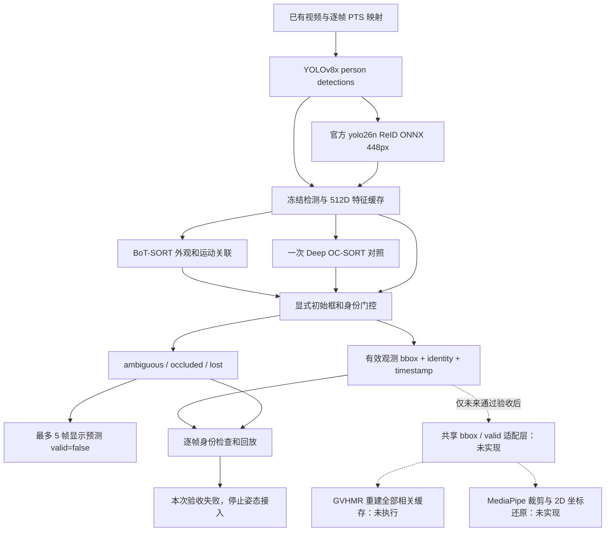

# 实现范围与输出约定

成熟部分为 Ultralytics 8.4.182 的 BoT-SORT / Deep OC-SORT 及真实人体 ReID。`target_policy*.py` 是本次实验自定义的保守目标身份层，不能称作经过验证的成熟身份锁定产品。它每帧检查候选检测，只有有已确认 tracker ID 的候选可以接受；数字 ID 参与恢复连续性，不能代替外观身份。所有候选理由都写入 JSONL。

## 已实现的记录

| 字段 | 含义 |
|---|---|
| `input_frame`, `input_timestamp_ms`, `source_frame`, `source_pts_seconds` | 输入帧与真实来源的对应关系 |
| `target_identity` | 显式初始目标，不依赖某个永久数字 ID |
| `state` | initialized / tracked / reacquired / ambiguous / occluded / lost |
| `valid`, `observed` | 仅被接受的实际检测为 true；它仍须视觉验收，不是概率或真值 |
| `bbox_xyxy` | 原输入像素中的检测框；无效时必须 null |
| `display_bbox_xyxy`, `display_box_kind` | 展示用实际框，或最多距最近观测 5 帧的预测框；预测始终无效 |
| `track_id`, `last_observed_track_id` | 当前关联 ID 或最近已接受 ID |
| `candidates`, `reason` | 外观、负样本、竞争候选、重叠、运动与尺寸检查 |
| `template_updated`, `template_updates_total` | 可追溯的图库更新 |

v3 始终保留最初外观模板，图库最多 32 项。沿用的配置字典包含 v1 遗留键，`anchor_similarity_min=0.7`、`reacquire_similarity_min=0.78`、`template_update_interval_frames` **不是 v3 的实际逐帧门控阈值**。v3 使用 `anchor_similarity_floor=0.25`、`gallery_similarity_min=0.65`；连续与长缺失恢复的图库阈值相同，但恢复要求同 ID 连续确认两次。超过 30 帧缺失后不再检查中心位移，仍检查尺寸和外观。这是存在风险的当前实验行为，不能描述为永不放松运动约束。

v3 的模板更新要求已接受的连续观测、检测置信度至少 0.65、首视角至少 0.3、图库至少 0.65、负样本差值至少 0.2、竞争候选差值至少 0.15、其他检测重叠不超过 0.15。恢复首帧不更新。重叠策略仍会误判同一人的重复检测；本次不再为回归片段调整。

## 尚未实现的下游接入

只有目标跟踪验收通过之后，GVHMR 与 MediaPipe 才能消费同一份原图像素 bbox/valid/time 映射。缺失帧必须透传无效标记，不能用长时间外推伪造可靠观测。

未来裁剪应保存完整仿射变换（包括扩边、边界裁切、缩放和 letterbox）。MediaPipe 的二维图像坐标通过该变换的逆变换还原到原图；没有 padding 时才可用 `x = left + u * crop_width`、`y = top + v * crop_height`。MediaPipe world landmarks 的米制、身体局部坐标不能加上像素裁剪偏移。两类坐标必须保留各自定义。

GVHMR 的 bbox、ViTPose、HMR2、特征和最终预测等相关缓存应以输入 SHA、目标初始化、身份决策哈希、裁剪变换、模型版本为键重新生成；旧人物缓存不能复用为新目标结果。本实验仅保存此接入设计，没有宣称已完成适配、重算、3D 精度改善或姿态回归。
