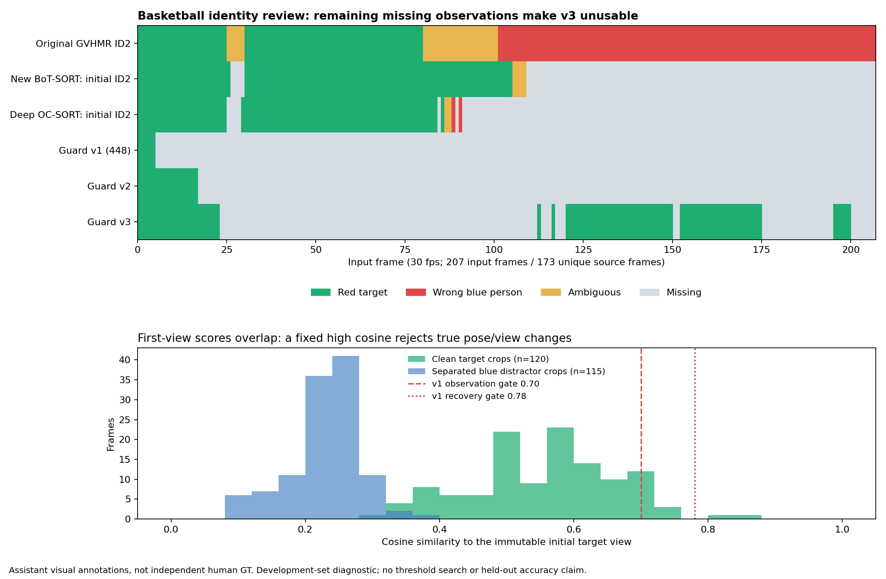

# 身份锁定实验：未通过验收

2026-10-18，分支 `research/identity-lock-2026-10-18`。这是失败实验及诊断交付，不是生产修复。新环境中的 BoT-SORT 确实调用了人体 ReID 并使用外观关联；加入身份门控后，篮球目标仍长时间漏跟。一次 Deep OC-SORT 对照也没有解决问题。**GVHMR / MediaPipe 的共享裁剪接入、重算和姿态效果验证均未执行。**

## 可核查结果

开发片段 `r2_occlusion_basketball` 有 207 个 30fps 输入帧、173 个独立原始帧，目标是红衣浅色短裤人物。第 0 帧框由助手按照用户描述目视选择；真人框选次数为 0，后续关键帧提示为 0。逐帧标签来自助手目视检查，不是独立人工真值。所有输入帧、所有 top-3 候选缩略图，以及 15 个困难帧的全部候选均已检查；红色像素排序只用于排列检查缩略图，没有进入跟踪算法。

| 输出 | 红衣目标 | 确定错跟蓝衣 | 身份不确定 | 无有效观测 | 清晰目标仍有检测时的误拒绝 |
|---|---:|---:|---:|---:|---:|
| 原 GVHMR 数字 ID2 | 75 | 106 | 26 | 0 | — |
| 新裸 BoT-SORT + ReID，初始数字 ID2 | 101 | 0 | 4 | 102 | — |
| 裸 Deep OC-SORT，初始数字 ID2 | 81 | 2 | 2 | 122 | — |
| 门控 v1，224 或 448 输入 | 5 | 0 | 0 | 202 | 116 |
| 保护图库 v2 | 17 | 0 | 0 | 190 | 104 |
| 保护图库 v3 + BoT-SORT | 83 | 0 | 0 | 124 | 65 |
| 同一 v3 + Deep OC-SORT | 83 | 0 | 0 | 124 | 65 |

“无有效观测”含算法的 ambiguous、occluded、lost 状态，并非宣称画面里没有目标。“清晰目标”要求逐帧目视判断清晰且检测置信度至少 0.2；共有 121 个这样的机会帧。v3 接受的 83 帧中还有 1 个不完整人体框（F112 截断腿部）；0 次错跟不等于 83 个框都适合姿态估计。v3 目标覆盖率为 40.10%，最长连续漏跟 89 帧（2.967 秒），恢复发生在 F112、116、120、152、195。

目标检测的逐帧质量标注为 124 帧清晰、75 帧与其他人重叠、1 帧没有单独目标检测（F26）、7 帧截断（F107、108、110、111、112、185、200）。红衣在这些画面中至少部分可见，但不能因此把混合框、截断框或无法判断身份的输出标为可靠。原始与裸跟踪器的不可判身份帧独立列为“不确定”，没有强行归为正确。

原 GVHMR 在 F101 起确定跟到蓝衣，F80–100 属于身份转换不确定区间，不能据此声称切换恰好发生在 F101。裸 Deep OC-SORT 的初始 ID 在 F88、F90 确定跟到蓝衣，F86、F87 不确定。裸 BoT-SORT 初始 ID 在 F105–108 不确定，F109 后消失。数字 ID 的持续本身不保证人物身份。

## 失败原因和已排除的问题

初始框和官方扩展裁剪内都是正确红衣目标；没有发现初始化被蓝衣污染。实际预处理为官方 `save_one_box(gain=1.02, pad=10)`、BGR 转 RGB、除以 255、双线性缩放、模型输出单位特征。动态 ONNX 的通用 helper 默认 224 与模型元数据 448 不一致，已单独保留 224 结果并以元数据 448 重跑；两者 v1 都只接受前 5 帧。

448 版本 F5 的裸 BoT-SORT 仍正确跟到红衣，首帧外观余弦却只有 0.631，低于 v1 的 0.7；它与前一帧的余弦为 0.813，运动和负样本条件也通过。一次拒绝随后触发更高的 0.78 恢复要求，形成首视角死锁。开发片段 120 个干净正样本的首帧余弦范围为 0.288–0.876，中位数 0.564；115 个分离蓝衣负样本为 0.086–0.387，中位数 0.236。范围重叠，107/120 正样本低于 0.7，118/120 低于 0.78。这是开发集描述，不能当作校准过的 ReID ROC 或泛化证明。

v2 改为受保护最近邻图库，但模板入库比接受观测更严格，只收进最初三个新增视角，又在 F17 陷入停滞。v3 允许已通过身份检查、唯一、高置信、低重叠的观测入库；恢复后第一帧不更新模板，同一数字 ID 也仍须过门控。它有 48 次模板更新、5 次恢复，但严重漏跟依旧存在。v3 是针对开发片段的诊断性修订，随后冻结，不再根据六段回归调参。并未训练或微调 ReID 模型。

真实 ReID 已验证：448 篮球运行有 207 次模型前向、1241 个 512 维向量、223 次官方外观代价调用（7262 对）；Deep OC-SORT 对照有 314 次外观代价调用（7381 对）。对照使用同一份冻结检测和真正的 ReID 向量，`model='auto'` 仅负责透传这些缓存向量，并非检测器特征。BoT-SORT 从缓存重放的 207 帧全部匹配原结果（绝对容差 0.0001），缓存前后 SHA256 相同。浮点框缓存键已改为 0.001 像素量化整数键；1241 个框特征对应关系、单位范数和无碰撞检查通过。最初发生过一次缓存键异常，在任何有效输出前停止，其失败记录仍保留。

v3 按检测候选的外观与运动证据选人，要求存在已确认的 tracker ID，并用 ID 判断连续/恢复；ID 不会豁免身份检查。两种 tracker 上 v3 恰好选择同一批检测，不是两套独立成功证据。这说明更换关联器未修复目前主要由门控和外观变化造成的漏跟。**本轮只有一个 yolo26n-reid 编码器；Deep OC-SORT 使用相同特征，尚未评测第二个编码器，不能泛化成所有 ReID 均失败。**

## 固定配置回归

六段回归只更换经目视确认的初始目标框，阈值与 v3 一致；无后续人工提示或姿态推理。回放包含全部 1434 输入帧。另检查均匀抽样与有效状态转换处共 95 帧，逐段帧号保存在 `metrics/holdouts/holdout-summary.json`。这部分没有逐帧身份真值，以下是 **valid 标记覆盖率，不是身份准确率**。

| 片段 | 有效 / 总帧 | 有效率 | 恢复次数 | 实测完整跟踪耗时 |
|---|---:|---:|---:|---:|
| 快速篮球 | 9 / 204 | 4.41% | 0 | 103.47s |
| 波比跳 | 215 / 300 | 71.67% | 12 | 56.89s |
| 过顶深蹲 | 240 / 240 | 100% | 0 | 49.08s |
| 单腿深蹲 | 210 / 210 | 100% | 0 | 45.62s |
| 芭蕾 A | 238 / 240 | 99.17% | 1 | 50.46s |
| 芭蕾 B | 226 / 240 | 94.17% | 5 | 53.93s |

样本中，快速篮球的原始框/裸 tracker 仍能覆盖粉红衣目标，门控却长期 lost；波比跳俯身时反复拒绝单人；芭蕾 A F37 与 B F115/F218 的画面只有一位舞者，却触发重叠歧义，暴露重复/局部检测的抑制不足。过顶深蹲和单腿深蹲的抽样框持续覆盖目标。抽样中未见接受其他人物，不能据此宣称整段零身份错误。芭蕾 A/B 来自同一视频和舞者，篮球场景也不构成广泛独立测试集。

运行平台为 RTX 4060 laptop 8GB，YOLO 用 CUDA，ReID ONNX 用 CPU。开发篮球 6.9 秒视频完整 448 跟踪耗时 84.269 秒，其中检测 18.225 秒、ReID 62.839 秒、关联 2.051 秒、v1 门控 0.112 秒；采样峰值 RSS 1,735,421,952 字节，CUDA 分配峰值 480,653,824 字节。v3 缓存重放 2.835 秒含反复读取压缩 NPZ，不是单纯门控耗时；Deep 对照测得门控本身约 0.129 秒。六段回归与证据渲染部分并行，以上是这次机器上的实测耗时，不是隔离性能基准或实时能力声明。

| 篮球阶段 | 实测秒数 | 计时范围 |
|---|---:|---|
| v1 / 224 | 41.383 | 完整检测、ReID、BoT-SORT、门控和逐帧记录 |
| v1 / 448 | 84.269 | 同上；更大的 ReID 输入 |
| v2 缓存重放 | 2.703 | 门控与压缩缓存读取，不含模型推理 |
| v3 缓存重放 | 2.835 | 同上 |
| 裸 BoT 缓存关联复核 | 0.948 | 仅关联调用，含 GMC |
| 裸 Deep 缓存关联 | 0.987 | 仅关联调用，含 GMC |
| Deep 对照中的 v3 门控 | 0.129 | 仅门控调用，不含缓存读取 |

这些不同计时口径不能直接排列成端到端速度优劣；原 GVHMR 为已有历史基线，本轮没有重测它的完整链耗时。

## 交付与复现

- [架构与输出约定](ARCHITECTURE.md)：已实现与尚未接入部分分开标明。
- [复现说明](REPRODUCE.md)、[依赖和素材许可](THIRD_PARTY.md)。
- `metrics/visual-evaluation/`：207 帧目视标签、每版本逐帧结果、误拒绝/错接受计数与特征分布。
- `metrics/attempts/`：包括失败在内的冻结配置、运行摘要和清单；原始运行摘要中的 `PENDING` 保留历史状态，以最终 `visual-evaluation/evaluation-summary.json` 为准。
- `figures/identity-diagnostic.png`：身份时间线和首视角相似度分布。
- 独立附件：篮球四画面对照 MP4、同输入六方案对照 MP4、六段回归 MP4、源码/报告/冻结数据 ZIP、候选检查图片 ZIP；每份小于 20,000,000 字节。权重、视频和特征二进制不提交 Git。

实验目录、venv 和缓存与旧项目隔离。源码仅在新分支的本目录内增加；主分支与旧研究分支未合并或覆盖。现有输入视频哈希不变。当前阻碍是技术验收失败，不是权限或下载失败。后续建议先建立可靠的人体检测与重复框处理，在最少额外门控下评测原始关联器，再用同一检测集比较更适配运动/遮挡的第二个 ReID 编码器；以独立人工标签同时检查错人和漏跟，最后才评估姿态接入。本轮停止进一步阈值微调和新模型尝试，失败候选不得替换基线。
